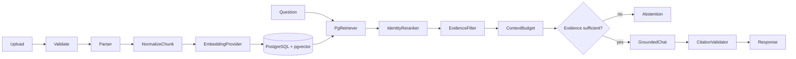

# Arquitetura e invariantes

## Capacidades

`knowledgebase` expõe o contrato HTTP. `document` persiste identidades. `ingestion`, `chunking` e `embedding` constroem o corpus. `retrieval`, `security`, `generation` e `citation` formam o caminho de pergunta. `evaluation` mede os resultados. SQL com `JdbcClient` é uma decisão explícita: o formato de publicação e a consulta de isolamento ficam visíveis e testáveis, sem uma cadeia opaca de Advisors.

## Publicação e recuperação

O checksum SHA-256 cobre os bytes originais. `UNIQUE(kb_id,checksum)` decide a identidade mesmo sob corrida. Upload repetido devolve a identidade existente; não inicia retry de `FAILED` implicitamente. A mesma identidade pode ter nomes diferentes entre uploads; o primeiro nome persistido vence.

O claim por `UPDATE` publica uma versão UUID de tentativa e `PROCESSING`. Parsing e embeddings ocorrem fora de transações longas. Todos os vetores são validados antes de iniciar o commit. Uma única transação insere chunks, muda `active_version`, marca `READY` e remove versões anteriores. O retrieval exige simultaneamente `READY`, KB correta, versão ativa e versão de embedding configurada.

Em falha, a transação inteira faz rollback e o documento fica `FAILED` com código categorizado. Versões antigas eventualmente preservadas no rollback ficam invisíveis, pois a consulta exige `READY`. A reindexação suspende disponibilidade desse documento durante processamento e após falha; não atende a versão antiga como fallback silencioso.

Uma tentativa interrompida pode ser retomada por reindex explícito após 15 minutos. O novo claim substitui o token da tentativa. Uma tentativa antiga que termine tarde não pode ativar sua versão: o compare-and-set falha e a transação faz rollback. Uma falha antiga também não altera o estado da tentativa nova. Um processamento legítimo muito longo pode ser substituído depois da janela; não há heartbeat nesta milestone.

Os originais são guardados como `bytea` limitado, para reindexação sem depender de caminhos do cliente. Não há leitura de arquivo arbitrário pela API. A base não é um armazenamento ilimitado de documentos; quotas globais por corpus e política de retenção serão necessárias para serviço compartilhado.

## Retrieval

A FK composta `(kb_id,document_id)` impede atribuição de chunks a documentos de outra KB. Todo ramo SQL — vetorial e lexical — inclui `c.kb_id=:kb AND d.kb_id=:kb` antes de ordenar e limitar. O filtro opcional `documentId` acrescenta restrição; nunca substitui a KB. Não há interpolação de filtros SQL fornecidos pelo cliente.

Cosseno: `score = 1 - (embedding <=> queryVector)`. Exact search preserva um baseline simples para o corpus pequeno; o índice GIN atende FTS. Sem HNSW ou IVFFlat, tuning inventado ou benchmark de performance. FTS usa configuração `simple`, útil para códigos e termos, sem stemming por língua. RRF soma `1/(60+rank)` nos dois rankings truncados de candidatos. Os scores de RRF não são probabilidades e não usam o threshold de cosseno.

O endpoint técnico oferece VECTOR/LEXICAL/HYBRID. LEXICAL ordena somente por FTS, embora a implementação também calcule cosseno para manter metadata uniforme. A geração usa VECTOR. O threshold experimental de 0,65 é aplicado na montagem de contexto, não no endpoint de inspeção; resultados de inspeção podem ter score inferior. O benchmark compara recuperação antes desse gate, sem remover distractors para melhorar artificialmente resultados.

## Contexto e geração

O orçamento explícito soma texto e overhead por fonte até 6.000 caracteres. Dois passes priorizam diversidade de documentos; no máximo dois chunks por documento, sem truncar quotes. Igualdade textual normalizada remove cópias exatas; Jaccard remove near duplicates apenas dentro do mesmo documento e com os mesmos números. Fontes distintas quase iguais são preservadas, pois pequenas diferenças podem representar contradições. Fontes de outra KB, abaixo do threshold ou bloqueadas pelo filtro não chegam ao chat.

Sem fontes, `INSUFFICIENT_EVIDENCE` é decidido pelo backend. Com fontes, o modelo recebe system policy separada, evidência como user data separada e a pergunta. Ele devolve status e claims com IDs controlados `S1..Sn`; o backend exige referências em cada claim, valida membership/KB e monta quotes diretamente dos chunks. Nenhum source ID desconhecido é aceito.

`SOURCE_CONFLICT` exige pelo menos duas fontes citadas. O contrato pede explicação do desacordo sem escolher uma verdade sem suporte. A detecção semântica de contradições é responsabilidade probabilística do chat; o backend garante formato e proveniência, não detecção universal de contradições.

## Falhas e observabilidade

Embeddings/chat passam por executor fixo de dois workers e fila de quatro chamadas. Timeout cancela a tarefa; mesmo que o cliente HTTP ignore interrupção, o número de workers não cresce. Saturação retorna `*_BUSY`. JDBC tem timeout de cinco segundos e pool de cinco conexões. Não há retry automático que possa duplicar publicação ou amplificar carga.

Micrometer registra ingestões, falhas, chunks, latência de provider por estágio, candidatos, retrieval, respostas, abstention, tokens quando disponíveis e citações inválidas. Labels têm cardinalidade limitada; não contêm KB, pergunta, documentos, prompts ou IDs. Spring AI conserva sua observabilidade padrão sem habilitar registro de conteúdo sensível.

Logs ECS incluem correlationId criado pelo servidor. Eventos de ingestão incluem knowledgeBaseId/documentId; perguntas mantêm queryId/knowledgeBaseId no MDC. Não são registrados corpo do documento, vetor, pergunta, prompt ou resposta. CorrelationId também aparece no header e na resposta de query/erro.
